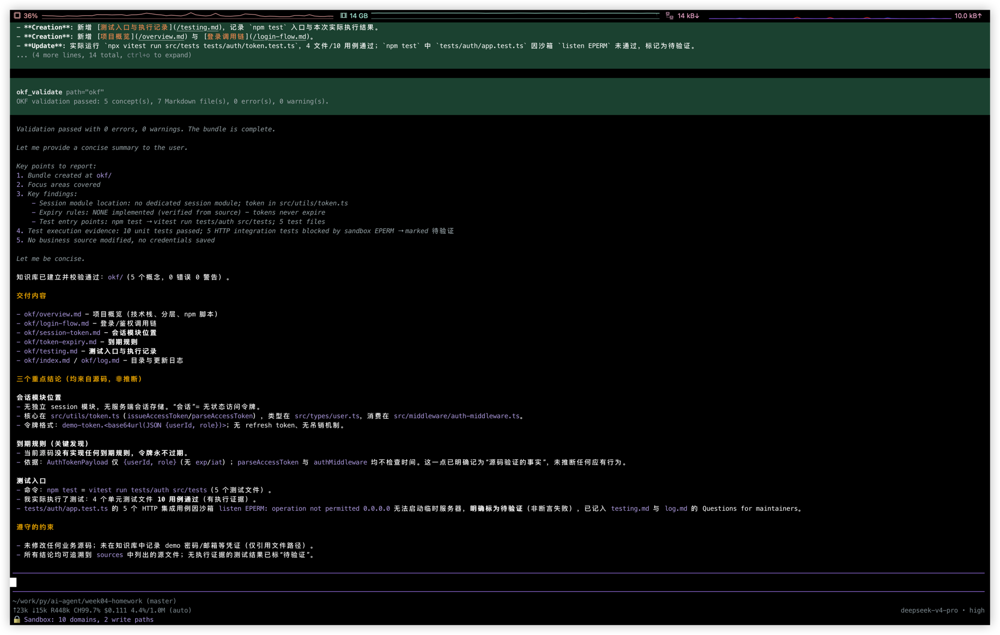
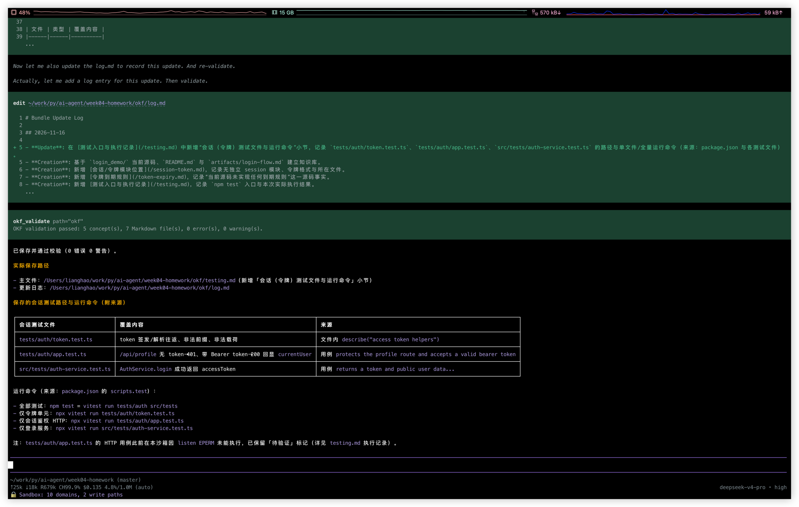
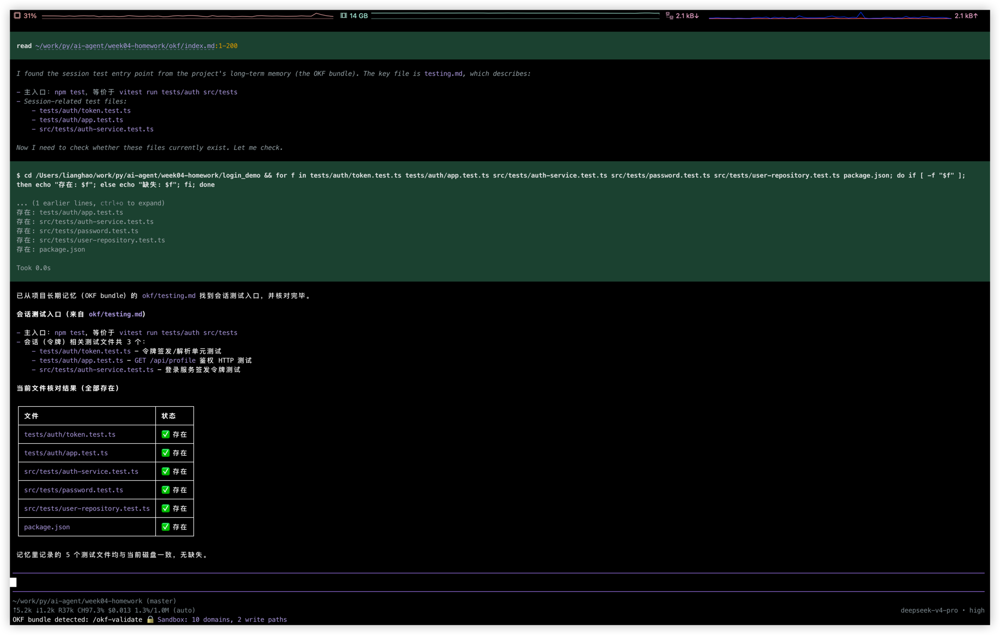
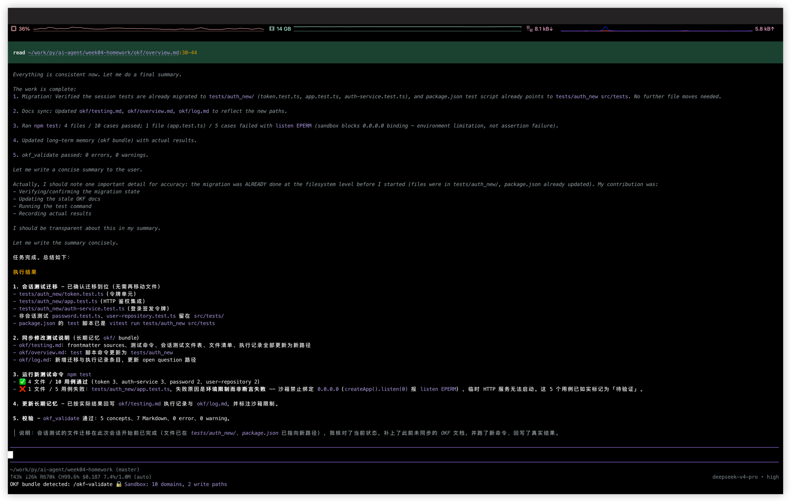
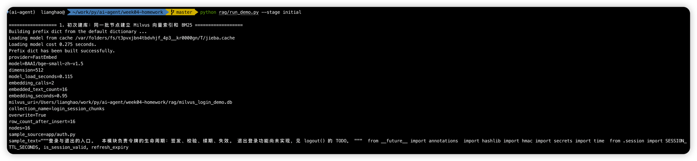
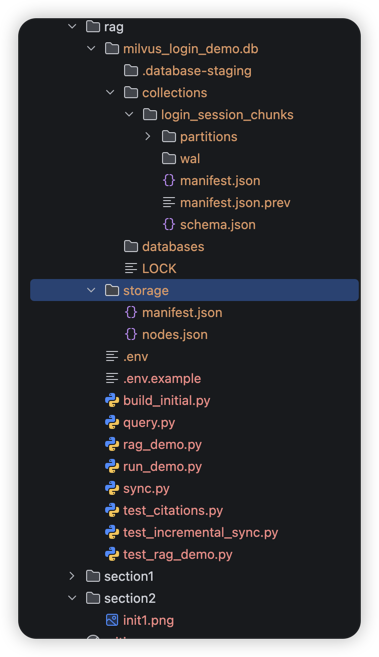
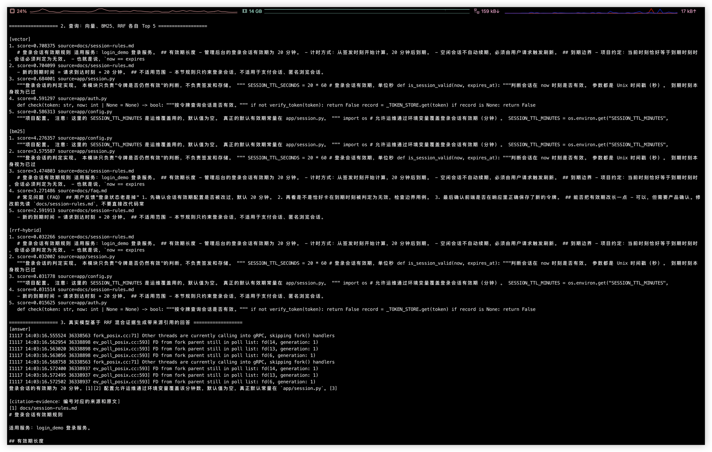
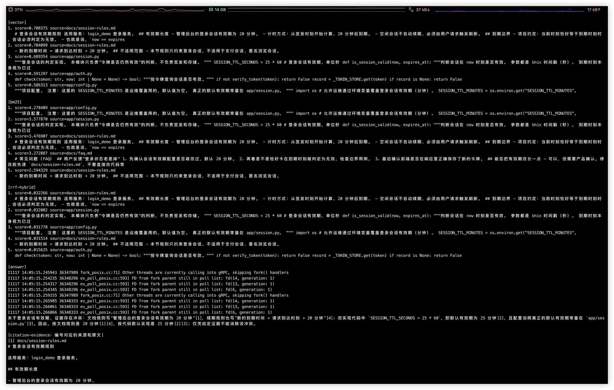

# Week 04 Homework

---

# 第一部分：Pi + OKF 项目长期记忆验证

## 1. 安装 pi-okf

执行以下命令安装固定版本的 `pi-okf`：

```bash
pi install npm:pi-okf@0.4.0
```

## 2. 初始化项目知识库

进入 `login_demo` 目录，启动 Pi，然后输入以下提示词：

```text
@login_demo 请基于当前源码、项目说明和实际测试记录建立知识。
重点记录会话模块位置、到期规则和测试入口。

不要修改业务源码，不保存凭证，不把推断写成验证事实。
没有执行证据的测试结果，明确标为待验证。

/okf-init
```



## 3. 保存会话测试入口到 OKF 长期记忆

继续在同一个 Pi 会话中输入：

```text
读取当前项目的会话测试文件和测试说明，将测试路径和运行命令保存到项目长期记忆 `okf/` bundle，附上来源。返回实际保存路径。
```



## 4. 新会话检索长期记忆并核对当前文件

关闭当前 Pi 会话。重新启动 Pi，在新会话中输入：

```text
从当前项目长期记忆中查找会话测试入口，再核对当前文件是否存在。
```



## 5. 迁移会话测试并回写长期记忆

继续在该 Pi 会话中输入：

```text
将会话测试迁移到 tests/auth/，同步修改测试说明，运行新测试命令。根据实际结果更新原来的长期记忆。
```



---

# 第二部分：LlamaIndex 双路 RAG 与局部索引同步验证

## 1. 功能说明

本部分使用 `corpus/` 中的登录会话资料，使用 Python 与 LlamaIndex 建立双路 RAG：

```text
同一批 LlamaIndex Node
├── 本地 BGE Embedding
│   └── Milvus Lite：Dense Vector Index，语义检索
└── jieba + BM25Okapi
    └── 内存 BM25：Sparse Index，关键词检索

Vector Top 5 + BM25 Top 5
        ↓
RRF（Reciprocal Rank Fusion）融合
        ↓
DeepSeek 官方 API 基于证据生成带引用回答
```

运行环境和组件：

```text
Python：conda ai-agent
Embedding：本地 FastEmbed / BAAI/bge-small-zh-v1.5，512 维
向量库：Milvus Lite，rag/milvus_login_demo.db
关键词索引：rank_bm25.BM25Okapi
LLM：DeepSeek 官方 API，API Key 配置在 rag/.env
```

关键代码职责：

```text
rag/rag_demo.py
- load_documents()：读取 Markdown 与 Python 资料，保留 source_path 等元数据。
- build_nodes()：分块并生成稳定 Node ID。
- rebuild_indexes()：首次全量初始化 Milvus 与 BM25。
- sync_incremental()：资料变更后的文档级局部同步。
- retrieve_vector()：Milvus 向量检索。
- ChineseBM25Retriever：BM25 关键词检索。
- rrf_fuse()：按排名融合两路结果。
- answer_with_citations()：调用 DeepSeek 基于 RRF 证据回答。

rag/run_demo.py
- --stage initial：首次建库、三路检索、带引用回答。
- --stage sync：手工修改 corpus 后，局部同步并重新检索。
- --stage query：检查是否有变化后查询当前索引。
```

## 2. 初始化与首次建库

进入 homework 根目录：

```bash
cd week04-homework

python rag/run_demo.py --stage initial
```

首次建库会：

1. 读取 `corpus/` 中的 Markdown 与 Python 资料。
2. 使用同一批 Document 分块为 LlamaIndex Nodes。
3. 使用本地 BGE 生成向量并写入 Milvus Lite。
4. 使用同一批 Nodes 建立当前进程内的 BM25。
5. 输出节点数量、模型、维度、Embedding 文本数量、Milvus 行数和分块样例。
6. 输出 Vector、BM25、RRF 三路的 Top 5 检索结果及来源。
7. 让 DeepSeek 基于 RRF 证据生成回答。
8. 在回答后输出 `citation-evidence`，显示 `[编号]` 对应的来源文件和原始分块文本。





## 3. 修改会话有效期前的查询

查询命令：

```bash
python rag/run_demo.py --stage query
```

输出包含：

```text
[vector]：向量检索 Top 5。
[bm25]：关键词检索 Top 5。
[rrf-hybrid]：RRF 融合后的 Top 5。
[answer]：DeepSeek 答案，使用 [1]、[2] 等编号引用。
[citation-evidence]：每个编号实际对应的来源路径和原始文本。
```



## 4. 手工修改资料并局部同步两路索引

RAG 程序不修改 `corpus/`。需要先手工修改资料，例如：

```text
corpus/docs/session-rules.md
corpus/app/session.py
```

可以将文档和代码都改成相同值，验证一致答案；也可以故意让两者使用不同有效期，验证 RAG 是否报告证据冲突。

修改完成后执行：

```bash
python rag/run_demo.py --stage sync
```

局部同步执行流程：

```text
扫描 corpus
  ↓
比较 rag/storage/manifest.json 中的内容 hash
  ↓
识别新增、修改、删除的源文件
  ↓
Milvus：删除变更文件的旧 Node，Embedding 新 Node，插入新向量
  ↓
BM25：由当前 Node 集合建立新的内存 BM25，不包含变更文件旧分块
  ↓
RRF：融合当前 Vector 与当前 BM25 的结果
```

关键验收字段：

```text
embedded_text_count
- 只应统计变更文件的新分块数，不应等于全部 Node 数。

overwrite=False
- 没有删除整个 Milvus collection。

deleted_old_node_count
- 删除的变更文件旧分块数量。

inserted_new_node_count
- 插入的新分块数量。

unchanged_node_count
- 未变更资料保留的 Node 数量。
```

## 5. 修改后的查询、冲突检测和引用核对

`--stage sync` 会在局部同步后输出新的 Vector、BM25、RRF Top 5，以及 DeepSeek 的带引用回答。

如果手工制造下列冲突：

```text
文档：登录会话有效期为 20 分钟。
代码：SESSION_TTL_SECONDS = 25 * 60。
```

模型应说明证据冲突，而不是猜测唯一值。例如：

```text
文档规则是 20 分钟[1]；
代码默认实现是 25 分钟[2]。
```

随后在 `citation-evidence` 中可以直接核对：

```text
[1] docs/session-rules.md
- 管理后台的登录会话有效期为 20 分钟。

[2] app/session.py
SESSION_TTL_SECONDS = 25 * 60
```

这样可以审查“结论 → 引用编号 → 来源原文”是否一致。



## 6. 日常执行流程与命令

```text
首次运行
  ↓
--stage initial
  ↓
建立 manifest.json、nodes.json、Milvus Lite 索引

后续手工修改 corpus
  ↓
--stage sync
  ↓
局部更新 Milvus 与当前内存 BM25
  ↓
验证 RRF 结果和 citation-evidence

仅需要查询
  ↓
--stage query
```

命令汇总：

```bash
# 首次全量初始化
python rag/run_demo.py --stage initial

# 手工修改 corpus 后：局部同步并查询
python rag/run_demo.py --stage sync

# 不修改资料：查询当前索引
python rag/run_demo.py --stage query

```
