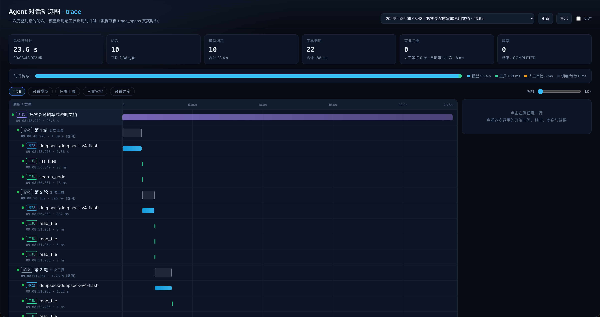

# week05/codebase-agent-homework

一个跑**真实模型**的 Codebase Agent：十件仓库工具都经过 TypeBox 契约、策略、预算、审计和沙箱；读操作自动执行，写入/执行操作按任务策略进入审批，审批可由人、审批图或指定身份（`--auto-approve`）答复。一次对话的每个模型/工具/审批调用都落进 `trace_spans`，可在轨迹图里按墙钟时间复盘。

## 安装与测试

```bash
npm ci
npm run check        # tsc --noEmit，无输出即通过
npm test             # 25 个文件 / 160 用例
```

## 真实模型验收

### 1. 准备凭据

两条 provider 路径，选一条：

```bash
# A. 直连 DeepSeek 原生 Chat Completions（本文实测走这条）
export DEEPSEEK_API_KEY='你的 DeepSeek Key'
export DEEPSEEK_BASE_URL='https://api.deepseek.com'

# B. 本机 ai-agent/app Gateway（需先启动，默认 :8000）
export GATEWAY_API_KEY='你的 Gateway Key'
```

`--provider deepseek|gateway` 决定 base URL、模型名和凭据变量。切 provider 时地址与变量一起换，运行时不会拿 Gateway 的 key 去判断 DeepSeek 有没有配好（见 `src/config.ts` 的 `ModelProfile`）。

<a id="acceptance-a"></a>

### 2. 验收 A：真模型 + 自动审批，一次跑通代码理解

```bash
HITL_MODE=disabled npm run cli -- --provider deepseek agent "把登录逻辑写成说明文档" \
  --task understand --auto-approve maintainer-auto
```

`HITL_MODE=disabled` 让审批单落在本地 SQLite（不请求 `:8383` 的图），`--auto-approve` 让 `maintainer-auto` 当场签字。单子照开、`args_digest` 照算、审计多记一条 `AUTO_APPROVED`，动作仍一次性领取。

实测（trace `fbb75d37-6f46-4917-8e54-9e9a582c8220`）：

- 8 轮、20 次工具调用，总时长 **13.8 s**（模型 13.6 s / 工具 0.3 s）
- 13,480 tokens；1 次自动审批（`apply_patch`，等待 13 ms）
- `stop: COMPLETED`、`acceptance: passed`、`missing: []`、0 条错误
- 交付物 `samples/1_login_demo/artifacts/login-flow.md` 写入成功，结论带 `文件:行号` 依据
- 轨迹图上一条「自动审批 · apply_patch」，`decided_by` 为 `maintainer-auto`

真模型的轮次波动很大：同一条命令另一次跑了 25 轮、57 次工具、101,435 tokens、37.3 s（trace `5894fda1-1b03-4eb8-835e-aef2b37c2bce`），中途还打错一次补丁上下文再重试。判断验收看 `stop`/`acceptance`，不要拿"轮数应该等于几"当标准。

终端判定只看三处：`[决策器] real:...`、`stop`、`acceptance`。模型文本说"已完成"不算数，交付物回读才算。

### 3. 验收 B：真模型 + 人工审批（LangGraph 图）

任务 `understand` 默认 `approval.via: http`，这是生产形态：模型想写文件时提单，人（或其他服务）答单，原进程继续。

```bash
# 终端一：起审批图
cd hitl && python3 -m venv .venv && .venv/bin/pip install -r requirements.txt
.venv/bin/uvicorn service:app --host 127.0.0.1 --port 8383

# 终端二：真模型，走图审批
HITL_MODE=http HITL_API_KEY=dev-key npm run cli -- --provider deepseek agent \
  "把登录逻辑写成说明文档" --task understand

# 终端三：每次出现新工单就查一次并批准
HITL_MODE=http HITL_API_KEY=dev-key npm run cli -- approvals tickets --task understand
HITL_MODE=http HITL_API_KEY=dev-key npm run cli -- approvals decide <approval-id> \
  --decision approve --actor reviewer --roles maintainer --task understand
```

图会拒绝 self-approval，审批者角色必须属于任务的 `approvers`。图不可达时运行以 `HITL_KEY_MISSING` / `HITL_UNREACHABLE` 停下，不会偷偷改成本地批准。本机验收时图服务未启动，这条链路只验证了"失败要说破"；要跑通需先起 `:8383`。

<a id="trace-ui"></a>

## 对话轨迹图（`trace-ui`）

一次完整对话 = 一条 `trace_id`。轨迹图用甘特/瀑布时间轴把它画出来：总运行时长、轮次、每次模型/工具/审批调用的开始时间（绝对时刻 + 相对偏移）、持续时长与内容摘要；并附调用类型、状态、父子关系、错误码、模型/工具名。



上图是一次真实对话（10 轮、22 次工具调用、23.6 s）：顶部六张卡是总时长/轮次/模型/工具/审批/异常，时间构成条显示模型占 99%；时间轴按「对话 → 轮次 → 模型 / 工具」三层展开，条长就是真实墙钟耗时；点任意一行，右侧出开始时刻、耗时、参数与结果。

```bash
npm run cli -- trace-ui --port 4317 --open
npm run cli -- trace-ui --port 4317 --trace-id <trace-id>
```

界面操作：点击任意一行看详情（参数、结果、tokens/成本、审批单、错误）；顶部可切换对话、按类型/异常筛选、1–8× 缩放、导出 JSON；打开"实时"每 2 秒轮询，只在新数据到达时重绘。

数据来源与约束：

- 时间来自 `trace_spans`：进入时写 `start_ms`、退出时写 `end_ms`，**不做事后估算**，条长就是真实墙钟耗时。
- 层级用 `parent_id` 表达：`run → turn → model / tool / approval / plan`；resume 复用同一 `trace_id`。
- 被门口/计划/审批拦下、从未执行的调用由 `beforeToolCall` 补记 `executed: false` 的零时长 span。
- 人工等待不在 `trace_spans` 里：collector 用 `approvals` 表的时间戳派生节点；门槛 span 已覆盖且等待 < 50 ms 时不重复画。
- 自动审批与人工审批靠 `hitl.approved` 事件的 `auto: true` 区分；图上分别写「自动审批」和「人工审批」，统计里是 `autoApprovals` / `humanApprovals`。
- 同一次工具调用的"执行失败"与"被拦标记"按 `tool_call_id` 去重，只留真正执行过的那条。

## 审批：四种形态

| 形态 | 配置 | 写操作时发生什么 |
|---|---|---|
| 不设门槛 | `approval.gate: none` | 直接执行，审计记 `APPROVAL_GATE_OFF` |
| 本地人工 | `via: local` | 落单 → `approvals decide` → `agent --resume <run-id>` |
| 审批图 | `via: http` | 落单并请求 `:8383`，原进程等待，人答单后自动续跑 |
| 自动审批 | 任意形态 + `--auto-approve <actor>` | 单子照开，指定身份当场签字，审计记 `AUTO_APPROVED` |

硬拒绝（禁写路径、契约违规、预算耗尽）不因自动审批放行。手动闭环命令：

```bash
npm run cli -- approvals list --status pending
npm run cli -- approvals decide <approval-id> --decision approve --actor reviewer --roles maintainer
npm run cli -- agent --resume <run-id>
```

## 配套文档

- [`docs/trace-ui-usage.md`](docs/trace-ui-usage.md) — 环境配置（三种模型接入、环境变量、审批四档含自动审批）→ 运行场景 → 读图与六种分析动作。
- [`docs/trace-ui-verification.md`](docs/trace-ui-verification.md) — 验证操作说明：页面五项硬指标、交互验收、数据库/API/页面三方对账、边界场景与验收清单。

## 持久运行与 `--plan`

`runs list` 展示持久运行的状态投影，`runs show <run-id>` 会先校验 checkpoint checksum 再输出完整运行状态。`agent --plan` 会创建 `plan:<run-id>`，并把首次受治理工具调用关联到唯一 `execute` 步骤：读操作记为 note、成功写操作记为 change 且推进代码版本、`run_test` 记为 test 和验证结果。收口时未完成步骤、失败测试或过期验证证据都会成为验收缺项。

## LangGraph 审批服务

```bash
cd hitl
python3 -m venv .venv && .venv/bin/pip install -r requirements.txt
.venv/bin/uvicorn service:app --host 127.0.0.1 --port 8383
```

`HITL_MODE=http` 时审批请求经 `POST /tickets` 进入 LangGraph 规则图；图拒绝 self-approval，审批者角色必须属于任务 `approvers`。工单状态与 CAS 决定结果由 SQLite 持久化，服务重启后仍可查询和答复。这里**没有使用 LangGraph interrupt 或 checkpointer 作为等待恢复机制**：运行时轮询 SQLite 工单，HTTP 模式下原 Agent 进程保持运行。

`eval` 子命令刻意未提供：它属于明确不做的跨任务批量评估入口。